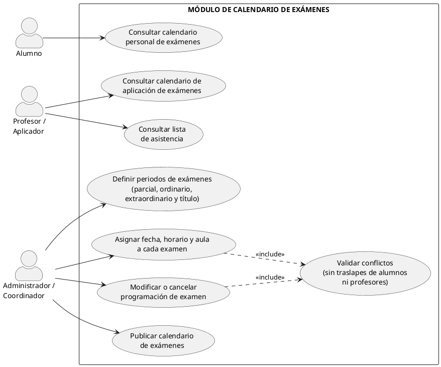

# Módulo Calendario de Exámenes

>
> Equipo 5
> (Jorge Uriel Vidal Morales, Melany Joana Toledo Escamilla, Alan Daniel Salas Gutierrez, Samuel Riveroll Vargas)
>

## Resumen
El **Módulo de Calendario de Exámenes** es la base para la planificación, organización y publicación de las evaluaciones académicas dentro del sistema de control escolar universitario. Su objetivo principal es automatizar y gestionar la programación de los diferentes tipos de evaluaciones (parciales, ordinarios, extraordinarios y título de suficiencia), garantizando la disponibilidad de aulas, evitando el traslape de horarios para alumnos y docentes, y facilitando la consulta centralizada en tiempo real.

## Objetivo y Alcance
### Objetivo
Automatizar y gestionar la planificación, organización y publicación de las evaluaciones académicas, asegurando la disponibilidad de espacios y evitando cruces de horarios para la comunidad estudiantil y docente.

### Alcance
Comprende la definición de periodos de evaluación, asignación de fechas, horarios y aulas, detección automática de conflictos por traslapes, publicación de calendarios y consultas personalizadas para alumnos, profesores y administradores.

## Requerimientos funcionales 
1. **RF-01 Programación de Periodos de Exámenes:** Permitir a la administración definir las ventanas de fechas hábiles para exámenes parciales y finales según el calendario lectivo.
2. **RF-02 Asignación de Horarios y Aulas:** Permitir la asignación de fecha, hora inicio/fin y aula física o virtual para cada asignatura.
3. **RF-03 Detección Automática de Conflictos (Validación de Traslape):** Validar que ningún estudiante o profesor tenga dos exámenes programados en el mismo bloque horario.
4. **RF-04 Consulta Personalizada del Estudiante:** Visualización del calendario de exámenes individual filtrado por la carga académica inscrita del alumno.
5. **RF-05 Consulta del Docente / Aplicador:** Visualización del calendario de aplicación de exámenes asignados y lista de asistencia.

## Actores
* **Administrador / Coordinador:** Usuario encargado de definir los periodos, asignar fechas, horarios y aulas, modificar o cancelar programaciones y publicar el calendario.
* **Alumno:** Usuario que consulta su calendario de exámenes personalizado según su carga académica.
* **Profesor / Aplicador:** Usuario que consulta su calendario de aplicación y las listas de asistencia correspondientes.

## Diagrama de casos de uso

(URL_DE_LA_IMAGEN_AQUI)

## Glosario y Abreviaturas
| Abreviatura / Término | Definición |
| :--- | :--- |
| **EX-PAR** | Examen Parcial: Evaluación periódica durante el semestre. |
| **EX-ORD** | Examen Ordinario: Evaluación final del curso regular. |
| **EX-EXT** | Examen Extraordinario: Evaluación de regularización para alumnos no acreditados. |
| **EX-TS** | Examen a Título de Suficiencia: Evaluación integral extraordinaria. |

## Requerimientos No funcionales
1. **RNF-01 Concurrencia:** Soportar la alta demanda de consultas por parte de los estudiantes al momento de la publicación del calendario.
2.
