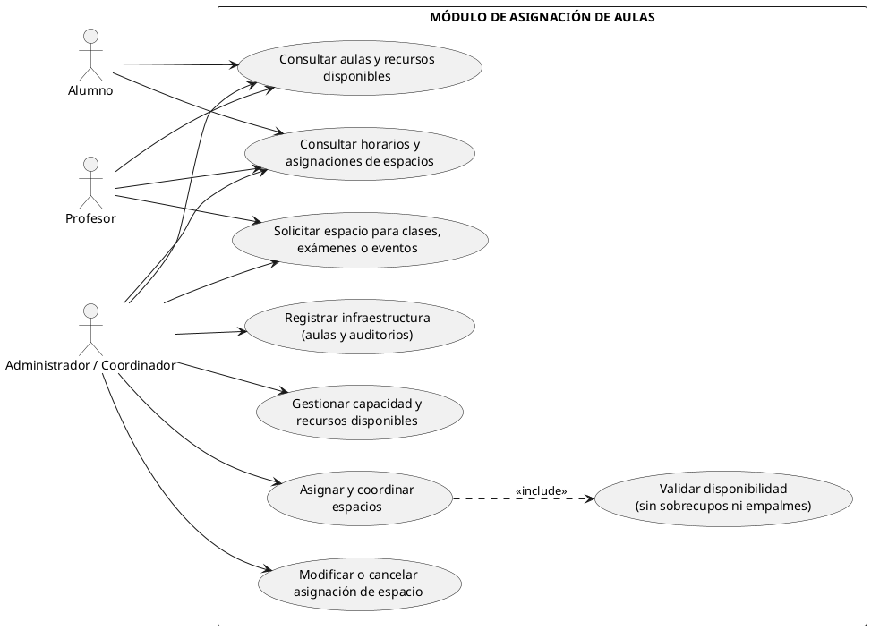

# Modulo Aulas

>
> Equipo 5
> (Jorge Uriel Vidal Morales, Melany Joana Toledo Escamilla, Alan Daniel Salas Gutierrez, Samuel Riveroll Vargas)
>

## Resumen
El **Módulo de Asignación de Aulas** es fundamental para el control, administración y optimización de los espacios físicos y virtuales de la institución educativa. Su objetivo principal es gestionar la infraestructura escolar (aulas y auditorios), registrar su capacidad y recursos disponibles, y coordinar la asignación de espacios para clases regulares, exámenes y eventos especiales, garantizando que no existan sobrecupos ni empalmes de horarios.

## Objetivo y Alcance
### Objetivo
Gestionar la infraestructura escolar (aulas y auditorios) y coordinar la asignación de espacios para clases regulares, exámenes y eventos especiales, garantizando que no existan sobrecupos ni empalmes de horarios.

### Alcance
Control, administración y optimización de los espacios físicos y virtuales de la institución educativa, registrando su capacidad y recursos disponibles para clases, exámenes y eventos.

## Requerimientos funcionales 
1. **RF-01 Registro y Gestión de Espacios:** Permitir dar de alta, modificar y dar de baja aulas y recintos, especificando número, edificio, tipo y capacidad de alumnos (ej. capacidad fija de 20 alumnos).
2. **RF-02 Control de Recursos e Instalaciones:** Registrar el equipamiento disponible en cada espacio (proyectores, computadoras, conectores).
3. **RF-03 Detección de Conflictos de Traslape de Espacio:** Validar en tiempo real que ningún aula sea asignado a dos clases, exámenes o eventos en el mismo bloque de horario.
4. **RF-04 Validación de Aforo y Capacidad:** Verificar que el total de alumnos inscritos en un grupo o examen no supere la capacidad máxima del aula asignada.

## Actores
* **Administrador / Gestor de Infraestructura:** Usuario encargado de dar de alta, modificar y dar de baja aulas y recintos, así como registrar el equipamiento disponible.
* **Coordinador Académico:** Usuario que coordina la asignación de espacios para clases regulares, exámenes y eventos especiales.
* **Sistema (Automatizado):** Componente encargado de validar en tiempo real los traslapes de horarios y la verificación del aforo y capacidad.

## Diagrama de casos de uso

(URL_DE_LA_IMAGEN_AQUI)

## Glosario y Abreviaturas
| Abreviatura / Término | Definición |
| :--- | :--- |
| **AUL-TEO** | Aula Teórica: Espacio físico destinado a clases magistrales o teóricas. |
| **AUD-CEN** | Auditorio Central: Espacio de alta capacidad para conferencias o evaluaciones masivas. |
| **CAP-AUL** | Capacidad del Aula: Límite máximo de alumnos permitidos por normativa de espacio/aforo. |

## Requerimientos No funcionales
1. **RNF-01 Tiempo de Respuesta en Validaciones:** Garantizar que la verificación de disponibilidad e idoneidad del aula se realice en menos de 5 segundos durante el proceso de programación de horarios y exámenes.
